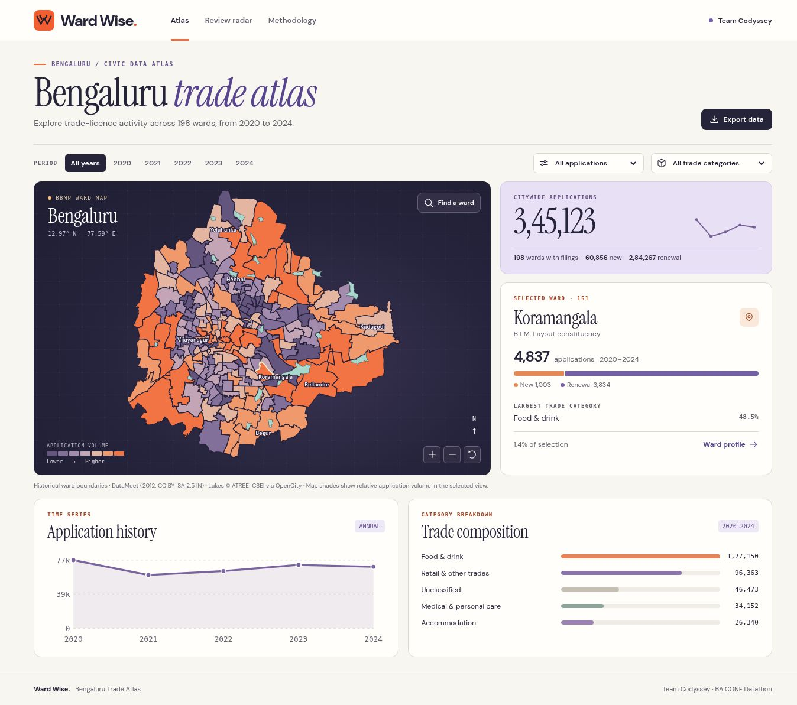

# Ward Wise · Bengaluru Trade Atlas

Ward Wise is a public civic-data atlas by Team Codyssey. It follows 345,123 unique BBMP trade-licence applications filed in calendar years 2020–2024. Residents, researchers and municipal teams can explore 198 historical wards, inspect a short quarterly queue of unusual changes in applications and keep a review log.



## Explore the atlas

[Live atlas](https://ward-wise-bengaluru.vercel.app/) · [Evidence lab, ward 85](https://ward-wise-bengaluru.vercel.app/#lab/85/1/19) · [Two-ward comparison](https://ward-wise-bengaluru.vercel.app/#lab/85/1/19/150)

- **Atlas.** Search any historical ward, filter the period, trade or filing type, inspect its profile and export counts. A filtered map address reopens the selected view.
- **Evidence lab.** Inspect any of the 198 wards, eight scored trades and 20 quarters. The lab shows raw local and peer denominators, the published expected count and band when eligible, the preceding quarter’s score and the reason for selection or exclusion. Compare any two wards using the same trade and quarter. Export the evidence as JSON or copy a link. All 5,472 eligible scores come from the Python run. Ineligible combinations still display their recorded counts.
- **Review radar.** Open a quarter or search all 22 historical cards. Save and revisit an assessment. Export your review log as JSON, or import a colleague’s export after previewing the number of new entries. Import keeps existing assessments and validates the complete file before saving. Historical device-local reviews remain readable. Public evidence links contain only record identifiers. Assessment notes stay in the browser until exported.
## Run locally

Clone the release branch, then start the frontend and API together with Python 3.11 or newer.

```sh
git clone --branch public-release https://github.com/ParvBhawsar/ward-wise-bengaluru.git
cd ward-wise-bengaluru
python3 scripts/serve.py 5173
```

Open <http://127.0.0.1:5173>. The public snapshot, fonts and database ship with the source. No API keys or package installation are needed. Reviews are stored by this browser for this origin. Use **Export reviews** to back them up before clearing site data or to transfer them to a different device.

## Explore a real case

1. Open **Atlas**. Hover over a ward to see its application count. Click to select it, or type its number or name under **Find a ward**. Zoom centres on the selected ward. Switch on **Relief view**, then press **Play timeline** to see annual filing volume change from 2020 to 2024. The six boundaries between colour bands stay fixed across annual views for a given set of filters.
2. Scroll to **Ward spotlight**. Pause on Bellanduru, select **Locate on map**, then open **Ward profile**. The 1,812 applications include 561 new filings and 1,251 renewals. The profile shows the five-year history and its trade mix.
3. Open **Review radar → Q4 2024 → Dodda Nekkundi**. The accommodation category has 36 filings, against a model estimate of 92.4. View the expected band, city share and data caveat, then enter a clearly labelled demonstration assessment.
4. Open **Methodology**. Show how the records were reconciled, how the expected counts are estimated, the controlled drop tests and the small held-out persistence comparison. Change to Q3 2024 in the radar to demonstrate a genuine empty queue.

## Reproduce the research

Use Python 3.11+ for the research scripts, and Node 20+ for the optional JavaScript syntax check. There are no runtime package dependencies. To regenerate the analysis from the committed public aggregate and run the checks:

```sh
npm run build
npm test
```

To recreate the aggregate from the upstream BBMP release:

```sh
python3 scripts/aggregate_bbmp.py --output dist/data
npm run build
```

The extraction script checks the compressed input SHA-256 before processing. Use `--source /path/to/source.csv.gz` for a locally archived copy of the specified release. Raw trader names, addresses and application IDs are excluded from application assets. The tests reconcile the checked-in aggregate digest, annual and type totals, map joins, uniqueness, review budgets and a common-city-shift scenario. CI checks that rebuilding reproduces the committed outputs.

## Project layout

| Path | Purpose |
| --- | --- |
| `dist/index.html`, `dist/assets/`, `dist/fonts/` | Responsive single-page web client, locally hosted fonts, cartography and interaction |
| `dist/data/application-counts.csv` | Shareable counts grouped by ward, quarter, category and application type |
| `dist/data/coverage.json` | Provenance, dates, denominators and completeness |
| `dist/data/atlas.json` | Browser representation, review queue and validation output |
| `dist/data/audit.json` | Eligible model scores and final selection decisions for the evidence lab |
| `dist/data/wards.json`, `lakes.json` | Projected boundary paths and lake outlines |
| `api/evidence.py`, `server/evidence.sqlite3` | Public evidence service and versioned, read-only SQLite database |
| `scripts/` | Reproducible data acquisition, ward crosswalk, geography and analysis |
| `tests/`, `.github/workflows/` | Integrity checks and deterministic rebuild verification |
| `docs/figures/` | Seven report-ready screenshots of the running application |
| `docs/DATA.md`, `docs/GEOGRAPHY.md` | Published data sources, transformations and third-party licences |

## Interpretation

The model measures unusual **application mix** conditional on ward volume. The city adjustment excludes the focal ward. Quarters are comparable against the same quarter in preceding years. No closure labels, licence due dates, causal effect estimates or business survival outcomes are available. The working uncertainty bands have not been calibrated against field audits. Only two of six evaluable early-2024 selected cases persisted for one more quarter. The screenshots include a simulated human review clearly labelled within its note.

## Public API and deployment

Evidence Lab requests `GET /api/evidence?ward=85&category=1&peer=150`. The ward number is 1–198, the trade index is 0–7 and the comparison ward is optional. The response includes model parameters and 20 quarterly records per requested ward. Each record includes local and comparison-city counts, the model decision and, when eligible, the expected count and band. Historical periods use the 198-ward geography in the source release.

The Vercel Python function queries the bundled SQLite database in read-only mode. Only aggregate counts and model outputs are served. Successful responses can be cached at the edge for a day. Invalid queries return HTTP 400. If the API is unavailable, the lab uses the matching published snapshot shipped with that release. Review notes stay in the user's browser and are excluded from API requests and shared evidence links.

Vercel serves the assets from `dist/` and packages the database with the function using `vercel.json`. Run `npm run build` and `npm test` before deploying an updated research snapshot. After deployment, open the [public API example](https://ward-wise-bengaluru.vercel.app/api/evidence?ward=85&category=1) and check the final quarter for ward 85 (36 observed, 92.4 expected).

## Attribution

Application database adapted from BBMP via Vivek Matthew (Vonter), ODbL 1.0. Historical boundary data adapted from DataMeet, CC BY-SA 2.5 India. Lake outlines are adapted from ATREE-CSEI via OpenCity. Font files are subsets of DM Sans and Instrument Serif under the SIL Open Font License. Individual dataset licences and source links are in `docs/`.
