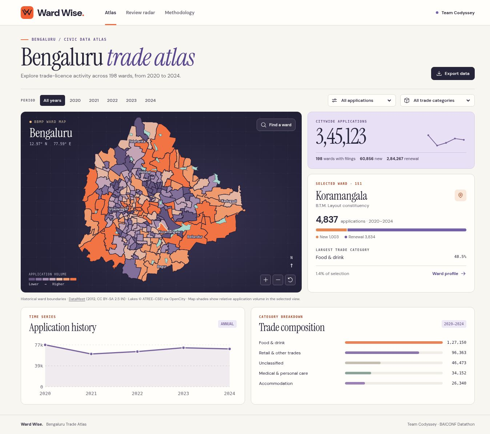

# Ward Wise · Bengaluru Trade Atlas

Team Codyssey built Ward Wise for the BAICONF Datathon Stage 2. The atlas follows 345,123 unique BBMP trade-licence applications filed in calendar years 2020–2024. Officers can explore 198 historical wards, inspect a short quarterly queue of unusual changes in applications and keep a review log.



## Run locally

The committed `dist/` is a deployable offline-capable static asset directory. The app makes no third-party runtime requests and needs no API keys. Start a local HTTP server from the repository root with Python 3.

```sh
python3 -m http.server 5173 --bind 127.0.0.1 --directory dist
```

Open <http://127.0.0.1:5173>. The app must be served over HTTP. Everything needed to show the real map, lake outlines, category filters, model cases and evaluation is bundled. New reviews are device-local and are tied to the site's origin. Use **Export reviews** for a shareable JSON copy. Clearing browser data clears local reviews.

## Demonstrate in two minutes

1. Open **Atlas**. Hover over a ward to see its application count. Click to select it, or type its number or name under **Find a ward**. Zoom centres on the selected ward. Switch on **Relief view**, then press **Play timeline** to see annual filing volume change from 2020 to 2024. The six boundaries between colour bands stay fixed across annual views for a given set of filters.
2. Scroll to **Ward spotlight**. Pause on Bellanduru, select **Locate on map**, then open **Ward profile**. The 1,812 applications include 561 new filings and 1,251 renewals. The profile shows the five-year history and its trade mix.
3. Open **Review radar → Q4 2024 → Dodda Nekkundi**. The accommodation category has 36 filings, against a model estimate of 92.4. View the expected band, city share and data caveat, then enter a clearly labelled demonstration assessment.
4. Open **Methodology**. Show how the records were reconciled, how the expected counts are estimated, the controlled drop tests and the small held-out persistence comparison. Change to Q3 2024 in the radar to demonstrate a genuine empty queue.

## Reproduce the research

Use Python 3.11+ for the research scripts, and Node 20+ for the optional JavaScript syntax check. There are no runtime package dependencies. To regenerate the analysis from the committed public aggregate and run the checks:

```sh
python3 scripts/build_analysis.py
npm test
```

To recreate the aggregate from the upstream BBMP release:

```sh
python3 scripts/aggregate_bbmp.py --output dist/data
python3 scripts/build_analysis.py
```

The extraction script checks the compressed input SHA-256 before processing. Use `--source /path/to/source.csv.gz` for a locally archived copy of the specified release. Raw trader names, addresses and application IDs are excluded from application assets. The tests reconcile the checked-in aggregate digest, annual and type totals, map joins, uniqueness, review budgets and a common-city-shift scenario. CI checks that rebuilding reproduces the committed outputs.

## Project layout

| Path | Purpose |
| --- | --- |
| `dist/index.html`, `dist/assets/`, `dist/fonts/` | Responsive single-page web client, locally hosted fonts, cartography and interaction |
| `dist/data/application-counts.csv` | Shareable counts grouped by ward, quarter, category and application type |
| `dist/data/coverage.json` | Provenance, dates, denominators and completeness |
| `dist/data/atlas.json` | Browser representation, review queue and validation output |
| `dist/data/wards.json`, `lakes.json` | Projected boundary paths and lake outlines |
| `scripts/` | Reproducible data acquisition, ward crosswalk, geography and analysis |
| `tests/`, `.github/workflows/` | Integrity checks and deterministic rebuild verification |
| `docs/figures/` | Seven report-ready screenshots of the running application |
| `docs/DATA.md`, `docs/GEOGRAPHY.md` | Published data sources, transformations and third-party licences |

## Interpretation

The model measures unusual **application mix** conditional on ward volume. The city adjustment excludes the focal ward. Quarters are comparable against the same quarter in preceding years. No closure labels, licence due dates, causal effect estimates or business survival outcomes are available. The working uncertainty bands have not been calibrated against field audits. Only two of six evaluable early-2024 selected cases persisted for one more quarter. The screenshots include a simulated human review clearly labelled within its note.

## Deployment and source control

Serve `dist/` on any static web host. For Vercel, import this repository and use the checked-in `vercel.json`. The output directory is `dist`; production assets are already built. No installation or build step is needed for serving. Changes to research inputs should rebuild and pass CI before deployment.

For a new GitHub remote, create an empty repository, set it as a remote and push the local `main` branch. Preserve existing remotes for separate deployments. The downloadable source bundle contains commit history in `ward-wise.bundle`, which you can clone with `git clone ward-wise.bundle ward-wise`.

## Attribution

Application database adapted from BBMP via Vivek Matthew (Vonter), ODbL 1.0. Historical boundary data adapted from DataMeet, CC BY-SA 2.5 India. Lake outlines are adapted from ATREE-CSEI via OpenCity. Font files are subsets of DM Sans and Instrument Serif under the SIL Open Font License. Individual dataset licences and source links are in `docs/`.
